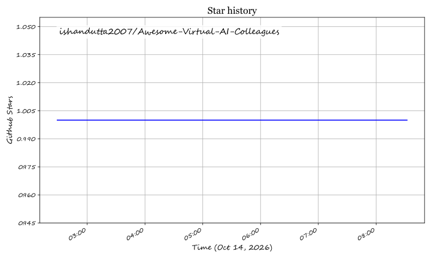

  

<h1 align="center">🤖 Awesome Virtual AI Colleagues</h1>

  <strong>A Curated Directory of Autonomous Digital Workers, Multi-Agent Workflows &amp; Enterprise AI Teammates</strong>

  
  
  
  
  
  
  

---

## 📌 Executive Summary & Index

This repository tracks the rapidly expanding frontier of **Virtual AI Colleagues** and **Autonomous Digital Workers**. Unlike conventional AI assistants that merely draft text or propose code completions, virtual AI colleagues independently orchestrate, execute, verify, and deliver complete business functions—ranging from autonomous sales pipeline generation (BDR/SDR) and full-lifecycle software engineering to voice customer support, healthcare revenue cycle management, and IT administration.

Whether you are evaluating production-ready **commercial SaaS platforms** or engineering custom **self-hosted open-source agent swarms**, this index provides transparent pricing, free-tier limits, market valuations, and technical architecture benchmarks.

---

## 📑 Table of Contents

- [📊 Sector Overview & Market Dynamics](#-sector-overview--market-dynamics)
- [🏢 SaaS & Hosted Commercial Platforms](#-saas--hosted-commercial-platforms)
- [💻 Open-Source GitHub Projects](#-open-source-github-projects)
- [🛠️ AI Workforce Architecture Frameworks](#️-ai-workforce-architecture-frameworks)
- [🤝 How to Contribute](#-how-to-contribute)
- [💖 Support & Sponsorship](#-support--sponsorship)
- [⚖️ Disclaimer & Compliance](#️-disclaimer--compliance)
- [⭐ Star History](#-star-history)

---

## 📊 Sector Overview & Market Dynamics

The global market for autonomous AI agents and digital workers is estimated at **$5.1 billion in 2024–2025** and is projected to surpass **$47.1 billion by 2030**, compounding at a rapid **CAGR of 44.8%**. 

The sector is currently **moderately fragmented and rapidly specializing** rather than exhibiting a winner-take-all monopoly:
- **Vertical Domain Specialization:** Deep vertical specialization creates enduring defensive moats. Autonomous software engineers (e.g., Cognition's Devin), high-throughput voice telephony agents (e.g., Bland AI), and regulated healthcare automation agents (e.g., Thoughtful AI) require complex domain integrations, compliance certifications (HIPAA, SOC 2, FedRAMP), and specialized execution sandboxes that general-purpose foundation models cannot easily displace.
- **Horizontal Multi-Agent Orchestration:** At the platform layer, commercial builders (Relevance AI, MindStudio) and open-source orchestration engines (Dify, MetaGPT, AutoGen, CrewAI) compete on workflow ergonomics, tool protocols (such as Model Context Protocol - MCP), and vendor-agnostic routing, maintaining a competitive, multi-vendor ecosystem for both enterprise buyers and self-hosting developers.

---

## 🏢 SaaS & Hosted Commercial Platforms

The following table presents leading enterprise and self-serve SaaS platforms for deploying autonomous AI colleagues, sorted in **descending order by company valuation / scale**:

| 🏢 Platform | 🎯 Core Role & Capabilities | 📈 Company Size / Valuation / ARR | 💳 Starting Tier Pricing | 🎁 Free Tier / Trial Limit | 🔑 Enterprise Highlights & Proof Points |
| :--- | :--- | :--- | :--- | :--- | :--- |
| **[Cognition (Devin)](https://cognition.com/)** | 💻 Autonomous Software Engineer (codes, tests, submits PRs, fixes bugs) | **$48B Valuation** ($1B ARR run rate; $2B+ funding) | **$20/month** (Pro Plan; $80/mo + $40/seat for Teams) | **Free Plan**: Light experimentation & limited ACU pool; 14-day enterprise pilot on request | 89% of Cognition code written by Devin; Mercedes-Benz (8 mos → 8 days); Goldman Sachs, Citi, US Navy, NASA JPL |
| **[Ema](https://www.ema.ai/)** | 👔 Universal AI Employee across HR, IT, Payroll, and Operations | **~$600M Valuation** ($140M funding; $77M Series B) | **$1,500/month** (Starting enterprise outcome contract) | **14-Day Enterprise Sandbox Pilot** with guided prebuilt HR/IT connector scoping | EmaFusion™ 100+ model routing (20× cost reduction); 250+ enterprise integrations; SOC 2 Type II, ISO 42001, HIPAA |
| **[Sema4.ai](https://sema4.ai/)** | ⚙️ Enterprise AI Runbooks & Context-Aware Back-Office Automation | **$505M Valuation** ($55.5M funding; acquired Robocorp) | **$0.10 / run minute** (Consumption Pay-as-you-go Tier) | **Developer Free Plan**: 1 workspace, 240 run minutes/month, AI & community support | Backed by Benchmark & Mayfield; Business Context Layer with 40+ MCP connections (Snowflake, SAP, Jira) |
| **[Bland AI](https://www.bland.ai/)** | 📞 High-Scale Autonomous Voice Telephony & Contact Center Agent | **$500M Valuation** ($100M+ funding; $50M Series C) | **$0.14/connected min** + $0.05/transfer min on Start Tier ($0 platform fee) | **Start Plan ($0/mo platform fee)** with $2 starter test credit; 10 concurrent calls & 100 calls/day cap | 1M+ simultaneous call capacity; sub-second latency across 40+ languages; Fortune 500 banks & hospital systems |
| **[11x](https://www.11x.ai/)** | 📈 Autonomous Sales Workers (Alice for Outbound SDR, Julian for Inbound Voice/Chat) | **~$400M Valuation** (~$14M ARR; $76M funding) | **$2,417/month** ($29K/yr billed annually for Julian; $3,750/mo for Alice SDR) | **Sales-Led Guided Pilot**: Custom sandbox demo upon qualification (no public self-serve tier) | a16z & Benchmark backed; 24/7 multichannel outbound execution; trusted by Xerox, Sage, Checkr, Rho, UST |
| **[MindStudio](https://www.mindstudio.ai/)** | 🎨 Visual No-Code Agent & Enterprise Workforce Builder | **~$200M Valuation** ($36M funding; parent YouAi/GoMeta) | **$20/month** ($16/mo billed annually on Individual Plan) | **Free Plan**: 1 published live agent, 1,000 runs/month, zero-markup model access | 500+ actions in MindStudio Connector Registry (MSCR); custom UI vibe-coding; certified devs at Amazon & IBM |
| **[Lindy](https://www.lindy.ai/)** | 📅 Autonomous Executive Assistant (email triage, calendar, CRM, voice phone) | **~$150M Valuation** ($5M+ ARR; $54M funding) | **$29.99/month** (Plus Plan with 3,000 task credits/month) | **7-Day Free Trial** with full access to standard task credits (permanent free tier retired) | Coatue & Battery backed; SOC 2 Type II, HIPAA, PIPEDA compliant; multi-channel control via Slack, SMS, email |
| **[Artisan AI](https://www.artisan.co/)** | 🎯 Autonomous Outbound BDR (Ava researches leads, personalizes, books meetings) | **~$120M Valuation** ($6M+ ARR; $46.5M funding) | **$250/month** (Intern Plan billed annually, 12,000 credits/mo) | **Free Plan**: 300 credits/month (or 30-day trial with 10,000 testing credits) | HubSpot Ventures backed; real-time buyer-intent web scraping; customers include SumUp, Remote, Quora |
| **[Relevance AI](https://relevanceai.com/)** | 🤝 Collaborative B2B Multi-Agent Workforce & Autonomous Process Mapping | **$100M+ Valuation** ($37M funding; $24M Series B) | **$19/month** ($19/mo billed annually or $29/mo monthly on Pro) | **Free Plan**: 200 Actions/month + initial vendor evaluation credits, 1 user seat | Bessemer & Insight Partners backed; Invent 2.0 automatic SOP mapping; zero-markup LLM pass-through pricing |
| **[Thoughtful AI](https://www.thoughtful.ai/)** | 🏥 Autonomous Healthcare Revenue Cycle Management (RCM) Digital Workers | **~$85M+ Valuation / Acquired** ($35M VC funding pre-merger) | **$2,000/month** (Entry RCM digital worker workflow tier) | **30-Day Proof-of-Value (POV) Pilot** with full CAM agent workflow setup (sales-assisted) | Acquired & merged into Smarter Technologies by New Mountain Capital; 235% ROI & 90% invoice time cut at Butterfly Effects |

---

## 💻 Open-Source GitHub Projects

For engineering teams seeking **complete data sovereignty**, **custom multi-agent architectures**, and **zero per-seat licensing**, the open-source ecosystem offers battle-tested frameworks. 

The table below is sorted in **descending order by GitHub Stars_Count**:

| 💻 Repository | 🌟 GitHub_Stars | 📜 License | 🏗️ Architecture & Primary Focus |
| :--- | :---: | :---: | :--- |
| **[AutoGPT](https://github.com/Significant-Gravitas/AutoGPT)** |  | MIT | General-purpose autonomous agent platform, agent protocol, modular blocks |
| **[Dify](https://github.com/langgenius/dify)** |  | Apache-2.0 | Production-grade LLM application & multi-agent workflow orchestration platform |
| **[OpenHands](https://github.com/All-Hands-AI/OpenHands)** |  | MIT | Autonomous AI software engineer with sandboxed terminal, browser, and IDE execution |
| **[MetaGPT](https://github.com/geekan/MetaGPT)** |  | MIT | Multi-agent framework encoding human SOPs into collaborative virtual company roles |
| **[Cline](https://github.com/cline/cline)** |  | Apache-2.0 | Autonomous coding agent with human-in-the-loop approval, browser control, MCP support |
| **[AutoGen](https://github.com/microsoft/autogen)** |  | CC-BY-4.0 | Microsoft multi-agent conversation orchestrator with event-driven distributed architecture |
| **[CrewAI](https://github.com/crewAIInc/crewAI)** |  | MIT | Role-playing autonomous agent collaboration framework for deterministic task execution |
| **[Goose](https://github.com/block/goose)** |  | Apache-2.0 | Block-developed Rust autonomous agent supporting CLI/desktop with 70+ MCP extensions |
| **[Aider](https://github.com/Aider-AI/aider)** |  | Apache-2.0 | Terminal AI pair-programmer with automated git history tracking and smart auto-commits |
| **[AgentGPT](https://github.com/reworkd/AgentGPT)** |  | GPL-3.0 | Web-based autonomous AI agent deployment platform with visual recursive reasoning loops |
| **[ChatDev](https://github.com/OpenBMB/ChatDev)** |  | Apache-2.0 | Virtual software development company simulating CEO, CTO, programmer, and tester roles |
| **[BabyAGI](https://github.com/yoheinakajima/babyagi)** |  | MIT | Pioneering task-driven autonomous agent architecture based on iterative task execution |
| **[SuperAGI](https://github.com/TransformerOptimus/SuperAGI)** |  | MIT | Infrastructure framework for running, managing, and benchmarking autonomous agent loops |
| **[OPC-Agents](https://github.com/lulin70/OPC-Agents)** |  | MIT | Autonomous execution team for one-person companies featuring Three Sages voting logic |

---

### 🔍 Deep Dive: Top Open-Source Frameworks

- **[AutoGPT](https://github.com/Significant-Gravitas/AutoGPT)**   
  The trailblazer that ignited autonomous AI agents. Features an ecosystem of modular blocks, web browsing, long-term memory management, and visual builders to chain independent agent workflows.

- **[Dify](https://github.com/langgenius/dify)**   
  Enterprise-ready open-source LLM app development and multi-agent coordination platform. Features visual orchestration canvas, RAG pipeline engine, observability, and native integrations with 50+ LLMs.

- **[OpenHands](https://github.com/All-Hands-AI/OpenHands)**   
  Premier open-source alternative to proprietary software engineering colleagues (Devin). Scores 77.6% on SWE-Bench with secure sandboxed terminal execution, browser automation, and native git workflows.

- **[MetaGPT](https://github.com/geekan/MetaGPT)**   
  Encodes Standard Operating Procedures (SOPs) into role-playing multi-agent swarms. Assigns roles (Product Manager, Architect, Project Manager, Engineer, QA) to deliver structured documentation, PRDs, and codebases from a single prompt.

- **[Cline](https://github.com/cline/cline)**   
  Autonomous coding colleague integrated directly into VS Code. Supports 46 model providers, human-in-the-loop permission checkpoints, browser testing, and Model Context Protocol (MCP) server integration.

- **[AutoGen](https://github.com/microsoft/autogen)**   
  Microsoft's distributed multi-agent conversation framework. Enables autonomous agent swarms to converse, negotiate, invoke tools, and solve complex multi-step reasoning problems asynchronously.

- **[CrewAI](https://github.com/crewAIInc/crewAI)**   
  Lean, production-focused multi-agent orchestration framework. Developers define specialist agents with explicit goals, backstories, tools, and delegation rules to execute complex business workflows.

- **[Goose](https://github.com/block/goose)**   
  Open-source general-purpose autonomous developer agent built in Rust by Block under the Linux Foundation. Offers desktop GUI, CLI, and API access with over 70+ plug-and-play MCP extensions.

- **[Aider](https://github.com/Aider-AI/aider)**   
  Terminal-native pair-programming agent that edits code in local git repositories. Features repository map indexing, automated commit message drafting, and multi-file refactoring.

- **[AgentGPT](https://github.com/reworkd/AgentGPT)**   
  Web-based autonomous agent execution interface that configures and runs autonomous agents directly in the browser with real-time thought visualization and goal decomposition.

- **[ChatDev](https://github.com/OpenBMB/ChatDev)**   
  Virtual software development enterprise where conversational agents act as CEO, CPO, CTO, and programmers, communicating via chat chains to design, code, and test applications from scratch.

- **[BabyAGI](https://github.com/yoheinakajima/babyagi)**   
  The classic minimalist framework that pioneered autonomous task creation, prioritization, and execution using OpenAI and vector storage embeddings.

- **[SuperAGI](https://github.com/TransformerOptimus/SuperAGI)**   
  Infrastructure framework providing agent telemetry, action consoles, multiple vector DB integrations, and an agent marketplace for running and scaling autonomous loops.

- **[OPC-Agents](https://github.com/lulin70/OPC-Agents)**   
  Open-source execution team for solo founders and one-person companies. Employs the **Three Sages Parallel Voting Architecture** (Strategist, Executor, Reflector) for verifiable consensus and deliverable production.

---

## 🛠️ AI Workforce Architecture Frameworks

To assemble a 100% self-hosted, sovereign Virtual AI Colleague stack, engineering teams frequently combine complementary open-source layers:

1. **Local Foundation Inference:** Run [Ollama](https://github.com/ollama/ollama), [vLLM](https://github.com/vllm-project/vllm), or [llama.cpp](https://github.com/ggerganov/llama.cpp) for private, zero-telemetry LLM inference.
2. **Multi-Agent Orchestration:** Use [MetaGPT](https://github.com/geekan/MetaGPT) or [CrewAI](https://github.com/crewAIInc/crewAI) to assign discrete roles, responsibilities, and SOP handoffs.
3. **Execution Environment:** Deploy [OpenHands](https://github.com/All-Hands-AI/OpenHands) for secure sandboxed bash and browser execution.
4. **Tool & Protocol Interoperability:** Connect enterprise data silos via the **Model Context Protocol (MCP)** supported natively in [Cline](https://github.com/cline/cline) and [Goose](https://github.com/block/goose).
5. **Business Deliverable Automation:** Integrate [OPC-Agents](https://github.com/lulin70/OPC-Agents) for autonomous market research, financial ledger updates, and automated outbound communication.

---

## 🤝 How to Contribute

Contributions are welcome and vital to maintaining this directory!

1. 🍴 **Fork** this repository.
2. 📝 **Add or update** entries in `README.md` following the existing tabular and detailed formatting guidelines.
3. 🔎 **Verify**: Ensure links are official, pricing is specific, free-tier/trial terms are accurate, and GitHub Stars_Counts are verified.
4. 🚀 **Submit PR** with a concise description of what was added or updated.

---

## 💖 Support & Sponsorship

Thank you so much for exploring and supporting **Awesome Virtual AI Colleagues**! 🌟

If you found this ecosystem directory valuable for your research, team, or project, please consider showing your support:
- ⭐ **Star this repository** on GitHub to help others discover it.
- 🍴 **Fork and contribute** new open-source projects or SaaS platform updates.
- 📢 **Share** this repository with fellow engineers, founders, and AI practitioners on Twitter/X, LinkedIn, and Discord.
- ☕ **Buy a coffee / Sponsor**: If you would like to support ongoing maintenance and curation, you can sponsor directly via the [GitHub Sponsors Dashboard](https://github.com/sponsors/ishandutta2007).

  
  

---

## ⚖️ Disclaimer & Compliance

- 🛡️ **Community Curated:** This list is curated for technical research and architectural comparison. Listing does not constitute formal commercial endorsement.
- 🔒 **Data Protection:** Virtual AI colleagues handling production workloads must comply with regional and sector-specific privacy mandates (**GDPR, CCPA, HIPAA, EU AI Act**).
- 🛡️ **Security Safeguards:** Deploying autonomous agents with shell, file, or API access requires sandboxed runtime environments, prompt injection filtering, strict egress firewalls, and human-in-the-loop authorization gates.

---

## ⭐ Star History

  

## Star History

<a href="https://star-history.com/#ishandutta2007/Awesome-Virtual-AI-Colleagues&Timeline" align="center">
  <picture>
    <source media="(prefers-color-scheme: dark)" srcset="assets/ishandutta2007_Awesome-Virtual-AI-Colleagues_growth.svg">
    
  </picture>
</a>
